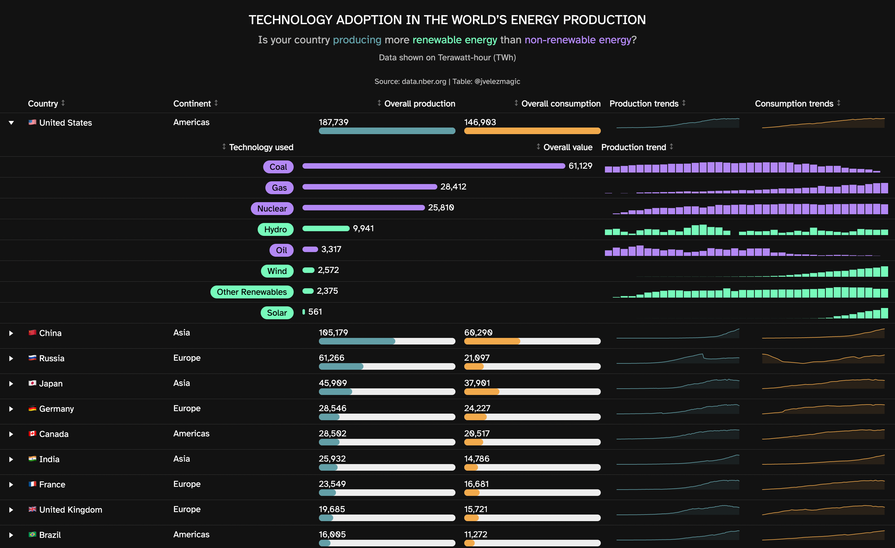

Energy production is a crucial aspect of our world’s technological landscape. As we move towards a future of sustainable energy, we need to assess how different countries are progressing in terms of the technologies they adopt for energy production. In this blog post, we’ll dive into some fascinating data obtained from the CHAT dataset, released under CCBY 4.0 and accessed via the National Bureau of Economic Research’s website.

Per the working paper:

> We present data on the global diffusion of technologies over time,
> updating and adding to Comin and Mestieri’s ‘CHAT’ database. We
> analyze usage primarily based on per capita measures and divide
> technologies into the two broad categories of production and
> consumption. We conclude that there has been strong convergence in use
> of consumption technologies with somewhat slower and more partial
> convergence in production technologies. This reflects considerably
> stronger global convergence in quality of life than in income, but we
> note that universal convergence in use of production technologies is
> not required for income convergence (only that countries are
> approaching the technology frontier in the goods and services that
> they produce).

## Preparing the Environment

To analyze the data, we’ll be using various packages in R, including `tidyverse` for data manipulation, `reactable` for creating interactive tables, `reactablefmtr` for enhancing our tables with sparklines and data bars, `tidytuesdayR` for accessing Tidy Tuesday datasets, `htmltools` and `htmlwidgets` for HTML content manipulation and widget creation, `countrycode` for converting country names and codes, and `dataui` for data visualization.

```r
library(tidyverse)
library(reactable)
library(reactablefmtr)
library(tidytuesdayR)
library(htmltools)
library(htmlwidgets)
library(countrycode)
library(dataui)
```

## Loading the Data

The dataset we’ll be using is a part of the Tidy Tuesday project, a weekly data project in R for data cleaning, wrangling, and visualization. The dataset, loaded using the `tidytuesdayR` package, contains information about the adoption of different technologies, specifically those related to energy production.

```r
tuesdata <- tidytuesdayR::tt_load('2022-07-19')

technology <- tuesdata$technology
```

Here’s a sample of the data we’re working with:

## Preparing the Data

In data analysis, the preparation stage is critical to ensure that the data is in the right format and structure for the subsequent analysis. In our case, we’re focusing on energy production technologies and have several steps to transform the raw data into a more digestible format.

### General processing

The general processing stage involves filtering and reshaping our dataset. Specifically, we filter the data to focus on energy production, excluding data related to electricity generation capacity. We also perform transformations to adjust the units for electricity consumption and extract information from labels to distinguish between different energy sources and statistics.

This information is then joined with a codelist that provides details such as the country name, continent, and a flag symbol. This enhances our dataset by adding relevant details and ensuring that the data is well-organized for our specific analysis.

```r
technology_processed <- technology |> 
  filter(
    group == "Production",
    category == "Energy",
    variable != "electric_gen_capacity"
  ) |>
  mutate(
    value = ifelse(
      test = variable == "elec_cons",
      yes = value / 1e9,
      no = value
    ),
    is_source_energy = str_detect(
      string = label,
      pattern = "Electricity from"
    ),
    is_energy_statistic = !is_source_energy,
    label = label |> 
      str_remove(pattern = "Electricity from ") |> 
      str_remove(" \\(TWH\\)") |> 
      str_to_title()
  ) |> 
  left_join(
    y = codelist |> 
      select(
        continent,
        country_name = country.name.en,
        iso3c,
        flag = unicode.symbol
      ),
    by = "iso3c"
  ) |> 
  mutate(
    country_name = paste(flag, country_name)
  ) |> 
  select(
    country_name,
    continent,
    year,
    label,
    variable,
    value,
    is_source_energy,
    is_energy_statistic
  ) |> 
  arrange(
    continent,
    country_name,
    variable,
    label,
    year
  )

technology_processed
```

    ## # A tibble: 58,976 × 8
    ##    country_name continent  year label variable  value is_source_energy is_ener…¹
    ##    <chr>        <chr>     <dbl> <chr> <chr>     <dbl> <lgl>            <lgl>    
    ##  1 🇦🇴 Angola    Africa     2000 Coal  elec_coal     0 TRUE             FALSE    
    ##  2 🇦🇴 Angola    Africa     2001 Coal  elec_coal     0 TRUE             FALSE    
    ##  3 🇦🇴 Angola    Africa     2002 Coal  elec_coal     0 TRUE             FALSE    
    ##  4 🇦🇴 Angola    Africa     2003 Coal  elec_coal     0 TRUE             FALSE    
    ##  5 🇦🇴 Angola    Africa     2004 Coal  elec_coal     0 TRUE             FALSE    
    ##  6 🇦🇴 Angola    Africa     2005 Coal  elec_coal     0 TRUE             FALSE    
    ##  7 🇦🇴 Angola    Africa     2006 Coal  elec_coal     0 TRUE             FALSE    
    ##  8 🇦🇴 Angola    Africa     2007 Coal  elec_coal     0 TRUE             FALSE    
    ##  9 🇦🇴 Angola    Africa     2008 Coal  elec_coal     0 TRUE             FALSE    
    ## 10 🇦🇴 Angola    Africa     2009 Coal  elec_coal     0 TRUE             FALSE    
    ## # … with 58,966 more rows, and abbreviated variable name ¹​is_energy_statistic

### Prepare overall values and list of trends

After the general processing, we summarize the data by calculating overall values for each technology and preparing a list of trends for each country. This provides a high-level view of energy production and consumption, allowing us to see which technologies are most prevalent and how these patterns have changed over time.

```r
technology_processed_summarized <- technology_processed |> 
  group_by(
    continent,
    country_name,
    variable,
    label
  ) |> 
  summarize(
    overall_value = sum(value),
    trend_values = list(value),
    is_energy_statistic = first(is_energy_statistic),
    is_source_energy = first(is_source_energy),
    .groups = "drop"
  )

technology_processed_summarized
```

    ## # A tibble: 2,016 × 8
    ##    continent country_name variable         label overa…¹ trend…² is_en…³ is_so…⁴
    ##    <chr>     <chr>        <chr>            <chr>   <dbl> <list>  <lgl>   <lgl>  
    ##  1 Africa    🇦🇴 Angola    elec_coal        Coal    0     <dbl>   FALSE   TRUE   
    ##  2 Africa    🇦🇴 Angola    elec_cons        Elec…  54.3   <dbl>   TRUE    FALSE  
    ##  3 Africa    🇦🇴 Angola    elec_gas         Gas    19.9   <dbl>   FALSE   TRUE   
    ##  4 Africa    🇦🇴 Angola    elec_hydro       Hydro  77.4   <dbl>   FALSE   TRUE   
    ##  5 Africa    🇦🇴 Angola    elec_nuc         Nucl…   0     <dbl>   FALSE   TRUE   
    ##  6 Africa    🇦🇴 Angola    elec_oil         Oil    16.7   <dbl>   FALSE   TRUE   
    ##  7 Africa    🇦🇴 Angola    elec_renew_other Othe…   0.886 <dbl>   FALSE   TRUE   
    ##  8 Africa    🇦🇴 Angola    elec_solar       Solar   0.157 <dbl>   FALSE   TRUE   
    ##  9 Africa    🇦🇴 Angola    elec_wind        Wind    0     <dbl>   FALSE   TRUE   
    ## 10 Africa    🇦🇴 Angola    elecprod         Gros… 155.    <dbl>   TRUE    FALSE  
    ## # … with 2,006 more rows, and abbreviated variable names ¹​overall_value,
    ## #   ²​trend_values, ³​is_energy_statistic, ⁴​is_source_energy

### Top energy producers

After the general processing, we summarize the data by calculating overall values for each technology and preparing a list of trends for each country. This provides a high-level view of energy production and consumption, allowing us to see which technologies are most prevalent and how these patterns have changed over time.

```r
top_energy_producers <- technology_processed_summarized |> 
  filter(is_energy_statistic) |> 
  pivot_wider(
    id_cols = c(continent, country_name),
    names_from = variable,
    values_from = overall_value
  ) |> 
  drop_na() |> 
  slice_max(
    elecprod,
    n = 50
  )

top_energy_producers
```

    ## # A tibble: 50 × 4
    ##    continent country_name      elec_cons elecprod
    ##    <chr>     <chr>                 <dbl>    <dbl>
    ##  1 Americas  🇺🇸 United States    146903.  187739.
    ##  2 Asia      🇨🇳 China             60290.  105179.
    ##  3 Europe    🇷🇺 Russia            21097.   61266.
    ##  4 Asia      🇯🇵 Japan             37901.   45909.
    ##  5 Europe    🇩🇪 Germany           24227.   28546.
    ##  6 Americas  🇨🇦 Canada            20517.   28502.
    ##  7 Asia      🇮🇳 India             14786.   25932.
    ##  8 Europe    🇫🇷 France            16681.   23549.
    ##  9 Europe    🇬🇧 United Kingdom    15721.   19685.
    ## 10 Americas  🇧🇷 Brazil            11272.   16005.
    ## # … with 40 more rows

### Global trends

To provide a comprehensive view of the energy landscape, we also prepare data for analyzing global trends in energy production and consumption. This involves selecting relevant countries from the top energy producers and pivoting the data to make it suitable for trend analysis.

```r
global_trends <- technology_processed_summarized |> 
  filter(
    country_name %in% top_energy_producers$country_name,
    is_energy_statistic
  ) |> 
  pivot_wider(
    id_cols = c(country_name, continent),
    names_from = variable,
    values_from = trend_values
  ) |> 
  inner_join(
    y = top_energy_producers |> 
      select(
        country_name,
        overall_consumption = elec_cons,
        overall_production = elecprod
      ),
    by = "country_name"
  ) |> 
  arrange(desc(overall_production)) |> 
  select(
    country_name,
    continent,
    overall_production,
    overall_consumption,
    production_trends = elecprod,
    consumption_trends = elec_cons
  )

global_trends
```

    ## # A tibble: 50 × 6
    ##    country_name      continent overall_production overall_cons…¹ produ…² consu…³
    ##    <chr>             <chr>                  <dbl>          <dbl> <list>  <list> 
    ##  1 🇺🇸 United States  Americas             187739.        146903. <dbl>   <dbl>  
    ##  2 🇨🇳 China          Asia                 105179.         60290. <dbl>   <dbl>  
    ##  3 🇷🇺 Russia         Europe                61266.         21097. <dbl>   <dbl>  
    ##  4 🇯🇵 Japan          Asia                  45909.         37901. <dbl>   <dbl>  
    ##  5 🇩🇪 Germany        Europe                28546.         24227. <dbl>   <dbl>  
    ##  6 🇨🇦 Canada         Americas              28502.         20517. <dbl>   <dbl>  
    ##  7 🇮🇳 India          Asia                  25932.         14786. <dbl>   <dbl>  
    ##  8 🇫🇷 France         Europe                23549.         16681. <dbl>   <dbl>  
    ##  9 🇬🇧 United Kingdom Europe                19685.         15721. <dbl>   <dbl>  
    ## 10 🇧🇷 Brazil         Americas              16005.         11272. <dbl>   <dbl>  
    ## # … with 40 more rows, and abbreviated variable names ¹​overall_consumption,
    ## #   ²​production_trends, ³​consumption_trends

### Specific trends

Lastly, we prepare data for analyzing specific trends in the use of various energy sources. This involves filtering the data for countries that are among the top energy producers and that have detailed data on energy sources. We also assign colors to each energy source for visual distinction in later stages of our analysis.

Through these steps, we’ve transformed our raw data into a well-structured and detailed dataset that’s ready for in-depth analysis. In the next section, we’ll be delving into data visualization, where we’ll use this prepared data to create an interactive table that presents a comprehensive view of global energy production trends.

```r
specific_trends <- technology_processed_summarized |> 
  filter(
    country_name %in% top_energy_producers$country_name,
    is_source_energy
  ) |> 
  mutate(
    energy_source_color = case_when(
      label %in% c("Coal", "Gas", "Nuclear", "Oil") ~ "#BB86FC",
      TRUE ~ "#19ffb6"
    )
  ) |> 
  arrange(desc(overall_value)) |> 
  select(
    country_name,
    energy_source = label,
    overall_value,
    trend_values,
    energy_source_color
  )

specific_trends
```

    ## # A tibble: 400 × 5
    ##    country_name     energy_source overall_value trend_values energy_source_color
    ##    <chr>            <chr>                 <dbl> <list>       <chr>              
    ##  1 🇨🇳 China         Coal                 71812. <dbl [36]>   #BB86FC            
    ##  2 🇺🇸 United States Coal                 61129. <dbl [36]>   #BB86FC            
    ##  3 🇺🇸 United States Gas                  28412. <dbl [36]>   #BB86FC            
    ##  4 🇺🇸 United States Nuclear              25810. <dbl [36]>   #BB86FC            
    ##  5 🇨🇳 China         Hydro                17547. <dbl [36]>   #19ffb6            
    ##  6 🇮🇳 India         Coal                 16959. <dbl [36]>   #BB86FC            
    ##  7 🇷🇺 Russia        Gas                  15802. <dbl [36]>   #BB86FC            
    ##  8 🇫🇷 France        Nuclear              13903. <dbl [36]>   #BB86FC            
    ##  9 🇨🇦 Canada        Hydro                12479. <dbl [36]>   #19ffb6            
    ## 10 🇧🇷 Brazil        Hydro                10993. <dbl [36]>   #19ffb6            
    ## # … with 390 more rows

## Visualizing the Data

Data visualization is an essential tool in the world of data science. It provides a clear, concise way to understand patterns, trends, and insights that might not be immediately apparent in raw, numerical data. To better appreciate the complexities of our data, we’ll now create an interactive table that showcases overall energy production and consumption trends across different countries and continents.

### Set global table appearance variables

To start, we need to set up the overall appearance of our table. This involves defining the style elements such as font, color schemes, and border details. In our case, we have chosen a dark theme for our table, with a background color of `#121212`, border color of `#3D3D3D`, and text color of white. We’ve also selected the font `Atkinson Hyperlegible` for its superior readability. The colors for production and consumption data are \#4DA1A9 and `#ffa630`, respectively, providing a clear distinction between the two.

```r
background_color <- "#121212"
border_color <- "#3D3D3D"
text_color <- "white"
font_family <- "Atkinson Hyperlegible"

production_color <- "#4DA1A9"
consumption_color <- "#ffa630"

reactable_theme <- reactableTheme(
    style = list(fontFamily = font_family),
    searchInputStyle = list(background = background_color),
    pageButtonStyle = list(fontSize = 14),
    backgroundColor = background_color,
    color = text_color,
    footerStyle = list(color = text_color, fontSize = 11),
    borderColor = border_color,
    borderWidth = 0.019
)
```

### Create table

With our style elements set, we now move on to creating the actual table. The table is designed to be highly detailed and interactive, providing a wealth of information at a glance while also allowing for deeper dives into specific data points.

Our table contains columns for country, continent, overall production, overall consumption, and respective trends. To make this data more digestible, we’ve used data bars for overall production and consumption, and sparklines for their trends.

The table also features a details section that, when a specific country is selected, provides additional information about the specific energy technologies used in that country, their overall values, and production trends.

The table is complemented by a text annotation at the top, providing a brief summary and context to the data displayed. It highlights the core question: “Is your country producing more renewable energy than non-renewable energy?”

```r
energy_production_table <- global_trends |> 
  reactable(
    theme = reactable_theme,
    columns = list(
      country_name = colDef(
        name = "Country"
      ),
      continent = colDef(
        name = "Continent"
      ),
      overall_production = colDef(
        name = "Overall production",
        cell = data_bars(
          data = select(global_trends, overall_production),
          round_edges = TRUE,
          text_position = "above",
          fill_color = production_color,
          bar_height = 12,
          text_color = text_color,
          number_fmt = scales::label_number(big.mark = ",")
        )
      ),
      overall_consumption = colDef(
        name = "Overall consumption",
        cell = data_bars(
          data = select(global_trends, overall_consumption),
          round_edges = TRUE,
          text_position = "above",
          fill_color = consumption_color,
          bar_height = 12,
          text_color = text_color,
          number_fmt = scales::label_number(big.mark = ",")
        )
      ),
      production_trends = colDef(
        name = "Production trends",
        cell = react_sparkline(
          data = select(global_trends, production_trends),
          line_color = production_color,
          show_area = TRUE
        )
      ),
      consumption_trends = colDef(
        name = "Consumption trends",
        cell = react_sparkline(
          data = select(global_trends, consumption_trends),
          line_color = consumption_color,
          show_area = TRUE
        )
      )
    ),
    showSortable = TRUE,
    showSortIcon = TRUE,
    defaultPageSize = 10,
    details = function(index) {
      
      current_country <- global_trends$country_name[index]
      current_country_table <- specific_trends |> 
        filter(country_name == current_country) |> 
        arrange(desc(overall_value))
      
      current_country_table |> 
        reactable(
          theme = reactable_theme,
          columns = list(
            country_name = colDef(
              show = FALSE
            ),
            energy_source = colDef(
              name = "Technology used",
              vAlign = "center",
              headerVAlign = "center",
              align = "right",
              cell = pill_buttons(
                data = current_country_table,
                color_ref = "energy_source_color"
              )
            ),
            overall_value = colDef(
              name = "Overall value",
              cell = data_bars(
                data = current_country_table,
                round_edges = TRUE,
                background = "transparent",
                text_position = "outside-end",
                text_color = text_color,
                fill_gradient = FALSE,
                fill_color_ref = "energy_source_color",
                number_fmt = scales::label_number(big.mark = ","),
                bar_height = 10
              )
            ),
            trend_values = colDef(
              name = "Production trend",
              cell = react_sparkbar(
                data = current_country_table,
                fill_color_ref = "energy_source_color"
              )
            ),
            energy_source_color = colDef(
              show = FALSE
            )
          ),
          showSortable = TRUE,
          showSortIcon = TRUE,
        )
    }
  ) |> 
  google_font(
    font_family = font_family
  )

text_annotation <- HTML("
  <div style='vertical-align:middle;text-align:center;background-color:#121212;color:white;padding-top:25px;padding-bottom:4px;font-size:24px;'>
  TECHNOLOGY ADOPTION IN THE WORLD'S ENERGY PRODUCTION
  </div>
  <div style='vertical-align:middle;text-align:center;background-color:#121212;color:#BBBBBB;padding-top:5px;padding-bottom:5px;font-size:20px;'>
  Is your country <span style='color: #4DA1A9'>producing</span> more 
  <span style='color: #19ffb6'>renewable energy</span> than
  <span style='color: #BB86FC'>non-renewable energy</span>?
  </div>
  <div style='vertical-align:middle;text-align:center;background-color:#121212;color:#BBBBBB;padding-top:5px;padding-bottom:20px;font-size:16px;'>
  Data shown on Terawatt-hour (TWh)
  </div>
  <div style='vertical-align:middle;text-align:center;background-color:#121212;color:#BBBBBB;padding-top:5px;padding-bottom:15px;font-size:14px;'>
  Source: data.nber.org | Table: @jvelezmagic
  </div>
")

energy_production_table_annotaded <- energy_production_table |>
  prependContent(
    text_annotation
  )

energy_production_table_annotaded
```



### Save table

Finally, we save our table as an HTML file using the `save_reactable_test` function from the `reactablefmtr` package. This will allow us to easily share the table with others, or embed it in a webpage for public viewing.

```r
reactablefmtr::save_reactable_test(
  input = energy_production_table_annotaded,
  output = "energy-production-table-annotaded.html"
)
```

Through effective data visualization, we can better understand the state of global energy production, see which countries are leading the way in renewable energy, and observe how production and consumption trends have changed over time. Stay tuned as we dive deeper into this rich dataset in future posts!

<details>
<summary>Session info</summary>

```text
## ─ Session info ───────────────────────────────────────────────────────────────
##  setting  value
##  version  R version 4.2.1 (2022-06-23)
##  os       macOS Ventura 13.3.1
##  system   aarch64, darwin20
##  ui       X11
##  language (EN)
##  collate  en_US.UTF-8
##  ctype    en_US.UTF-8
##  tz       Europe/Berlin
##  date     2023-05-12
##  pandoc   2.19.2 @ /Applications/RStudio.app/Contents/Resources/app/quarto/bin/tools/ (via rmarkdown)
## 
## ─ Packages ───────────────────────────────────────────────────────────────────
##  ! package       * version date (UTC) lib source
##    assertthat      0.2.1   2019-03-21 [2] CRAN (R 4.2.0)
##    backports       1.4.1   2021-12-13 [2] CRAN (R 4.2.0)
##    bit             4.0.4   2020-08-04 [2] CRAN (R 4.2.0)
##    bit64           4.0.5   2020-08-30 [2] CRAN (R 4.2.0)
##  P blogdown        1.16    2022-12-13 [?] CRAN (R 4.2.0)
##  P bookdown        0.34    2023-05-09 [?] CRAN (R 4.2.1)
##    broom           1.0.1   2022-08-29 [2] CRAN (R 4.2.0)
##    bslib           0.4.0   2022-07-16 [2] CRAN (R 4.2.0)
##    cachem          1.0.6   2021-08-19 [2] CRAN (R 4.2.0)
##    cellranger      1.1.0   2016-07-27 [2] CRAN (R 4.2.0)
##    cli             3.4.1   2022-09-23 [2] CRAN (R 4.2.0)
##    colorspace      2.0-3   2022-02-21 [2] CRAN (R 4.2.0)
##  P countrycode   * 1.4.0   2022-05-04 [?] CRAN (R 4.2.0)
##    crayon          1.5.2   2022-09-29 [2] CRAN (R 4.2.0)
##    curl            4.3.2   2021-06-23 [2] CRAN (R 4.2.0)
##  P dataui        * 0.0.1   2023-05-12 [?] Github (timelyportfolio/dataui@39583c6)
##    DBI             1.1.3   2022-06-18 [2] CRAN (R 4.2.0)
##    dbplyr          2.2.1   2022-06-27 [2] CRAN (R 4.2.0)
##    digest          0.6.29  2021-12-01 [2] CRAN (R 4.2.0)
##    dplyr         * 1.0.10  2022-09-01 [2] CRAN (R 4.2.0)
##    ellipsis        0.3.2   2021-04-29 [2] CRAN (R 4.2.0)
##    evaluate        0.16    2022-08-09 [2] CRAN (R 4.2.0)
##    fansi           1.0.3   2022-03-24 [2] CRAN (R 4.2.0)
##    fastmap         1.1.0   2021-01-25 [2] CRAN (R 4.2.0)
##    forcats       * 0.5.2   2022-08-19 [2] CRAN (R 4.2.0)
##    fs              1.5.2   2021-12-08 [2] CRAN (R 4.2.0)
##    gargle          1.2.1   2022-09-08 [2] CRAN (R 4.2.0)
##    generics        0.1.3   2022-07-05 [2] CRAN (R 4.2.0)
##    ggplot2       * 3.3.6   2022-05-03 [2] CRAN (R 4.2.0)
##    glue            1.6.2   2022-02-24 [2] CRAN (R 4.2.0)
##    googledrive     2.0.0   2021-07-08 [2] CRAN (R 4.2.0)
##    googlesheets4   1.0.1   2022-08-13 [2] CRAN (R 4.2.0)
##    gtable          0.3.1   2022-09-01 [2] CRAN (R 4.2.0)
##    haven           2.5.1   2022-08-22 [2] CRAN (R 4.2.0)
##    hms             1.1.2   2022-08-19 [2] CRAN (R 4.2.0)
##  P htmltools     * 0.5.5   2023-03-23 [?] CRAN (R 4.2.0)
##  P htmlwidgets   * 1.6.2   2023-03-17 [?] CRAN (R 4.2.0)
##    httr            1.4.4   2022-08-17 [2] CRAN (R 4.2.0)
##    jquerylib       0.1.4   2021-04-26 [2] CRAN (R 4.2.0)
##    jsonlite        1.8.0   2022-02-22 [2] CRAN (R 4.2.0)
##    knitr           1.40    2022-08-24 [2] CRAN (R 4.2.0)
##    lifecycle       1.0.2   2022-09-09 [2] CRAN (R 4.2.0)
##    lubridate       1.8.0   2021-10-07 [2] CRAN (R 4.2.0)
##    magrittr        2.0.3   2022-03-30 [2] CRAN (R 4.2.0)
##    modelr          0.1.9   2022-08-19 [2] CRAN (R 4.2.0)
##    munsell         0.5.0   2018-06-12 [2] CRAN (R 4.2.0)
##    pillar          1.8.1   2022-08-19 [2] CRAN (R 4.2.0)
##    pkgconfig       2.0.3   2019-09-22 [2] CRAN (R 4.2.0)
##    purrr         * 0.3.4   2020-04-17 [2] CRAN (R 4.2.0)
##    R6              2.5.1   2021-08-19 [2] CRAN (R 4.2.0)
##  P reactable     * 0.4.4   2023-03-12 [?] CRAN (R 4.2.0)
##  P reactablefmtr * 2.0.0   2022-03-16 [?] CRAN (R 4.2.0)
##  P reactR          0.4.4   2021-02-22 [?] CRAN (R 4.2.0)
##    readr         * 2.1.2   2022-01-30 [2] CRAN (R 4.2.0)
##    readxl          1.4.1   2022-08-17 [2] CRAN (R 4.2.0)
##    renv            0.15.5  2022-05-26 [1] CRAN (R 4.2.1)
##    reprex          2.0.2   2022-08-17 [2] CRAN (R 4.2.0)
##    rlang           1.0.6   2022-09-24 [2] CRAN (R 4.2.0)
##    rmarkdown       2.16    2022-08-24 [2] CRAN (R 4.2.0)
##    rstudioapi      0.14    2022-08-22 [2] CRAN (R 4.2.0)
##    rvest           1.0.3   2022-08-19 [2] CRAN (R 4.2.0)
##    sass            0.4.2   2022-07-16 [2] CRAN (R 4.2.0)
##    scales          1.2.1   2022-08-20 [2] CRAN (R 4.2.0)
##    selectr         0.4-2   2019-11-20 [2] CRAN (R 4.2.0)
##  P sessioninfo     1.2.2   2021-12-06 [?] CRAN (R 4.2.0)
##    stringi         1.7.8   2022-07-11 [2] CRAN (R 4.2.0)
##    stringr       * 1.4.1   2022-08-20 [2] CRAN (R 4.2.0)
##    tibble        * 3.1.8   2022-07-22 [2] CRAN (R 4.2.0)
##    tidyr         * 1.2.1   2022-09-08 [2] CRAN (R 4.2.0)
##    tidyselect      1.1.2   2022-02-21 [2] CRAN (R 4.2.0)
##  P tidytuesdayR  * 1.0.2   2022-02-01 [?] CRAN (R 4.2.0)
##    tidyverse     * 1.3.2   2022-07-18 [2] CRAN (R 4.2.0)
##    tzdb            0.3.0   2022-03-28 [2] CRAN (R 4.2.0)
##    usethis         2.1.6   2022-05-25 [2] CRAN (R 4.2.0)
##    utf8            1.2.2   2021-07-24 [2] CRAN (R 4.2.0)
##    vctrs           0.4.2   2022-09-29 [2] CRAN (R 4.2.0)
##    vroom           1.6.0   2022-09-30 [2] CRAN (R 4.2.0)
##    withr           2.5.0   2022-03-03 [2] CRAN (R 4.2.0)
##  P xfun            0.39    2023-04-20 [?] CRAN (R 4.2.0)
##    xml2            1.3.3   2021-11-30 [2] CRAN (R 4.2.0)
##    yaml            2.3.5   2022-02-21 [2] CRAN (R 4.2.0)
## 
##  [1] /Users/jvelezmagic/Documents/github/jvelezmagic/renv/library/R-4.2/aarch64-apple-darwin20
##  [2] /Library/Frameworks/R.framework/Versions/4.2-arm64/Resources/library
## 
##  P ── Loaded and on-disk path mismatch.
## 
## ──────────────────────────────────────────────────────────────────────────────
```

</details>
